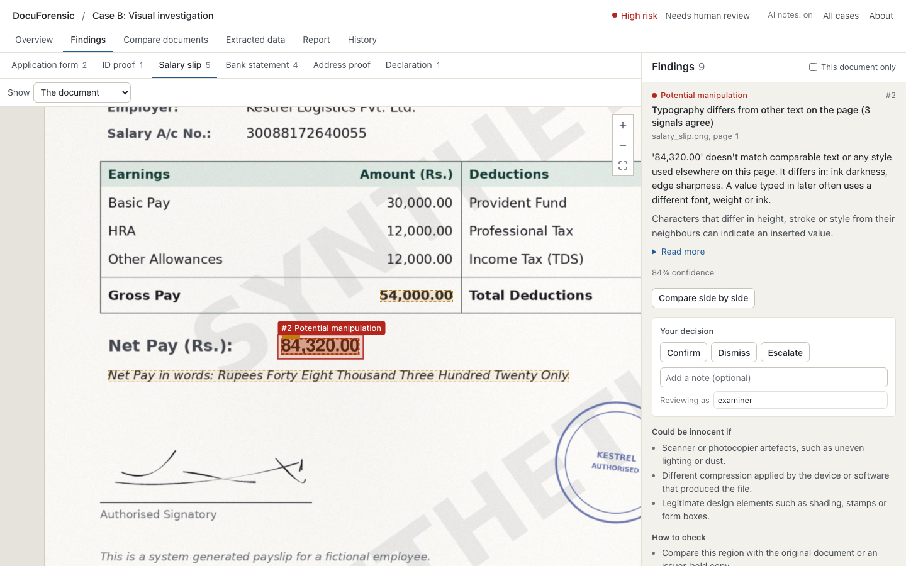
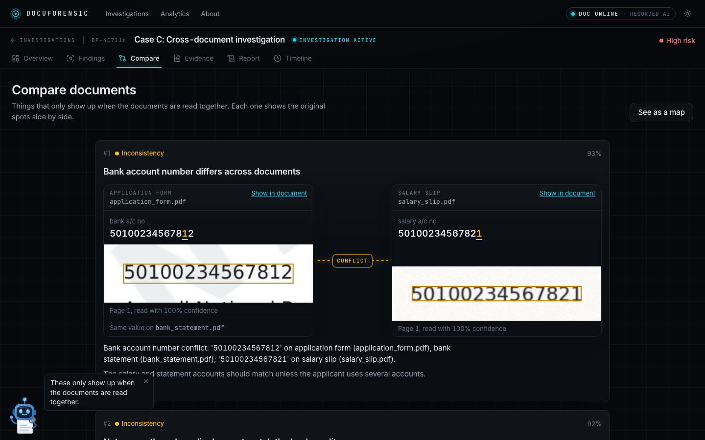
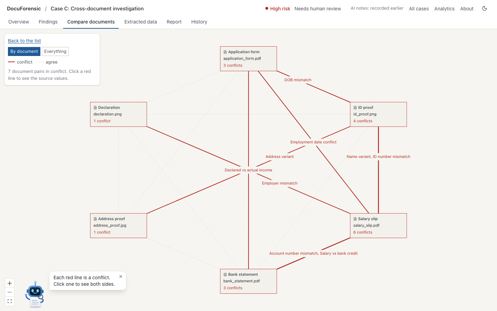
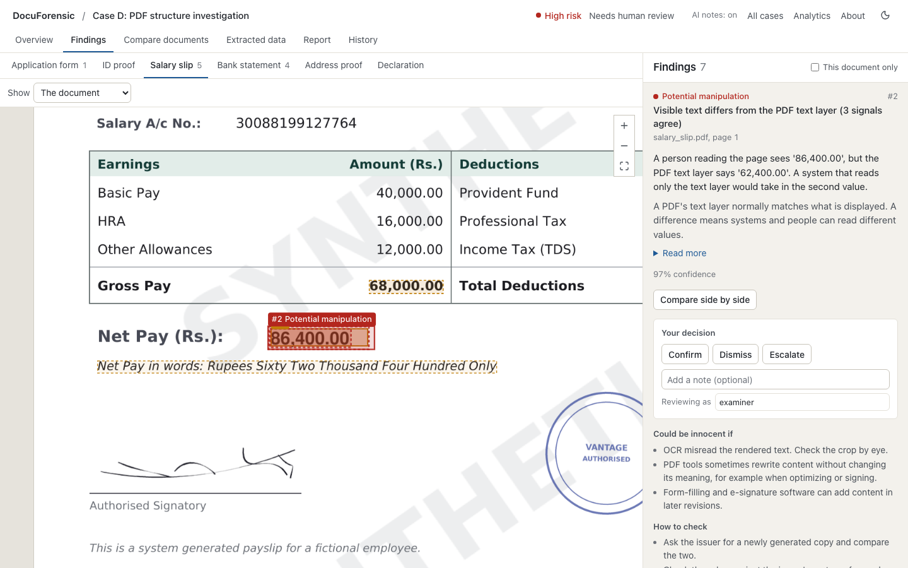
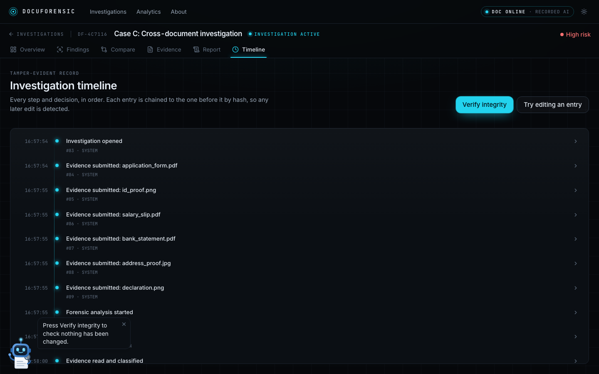
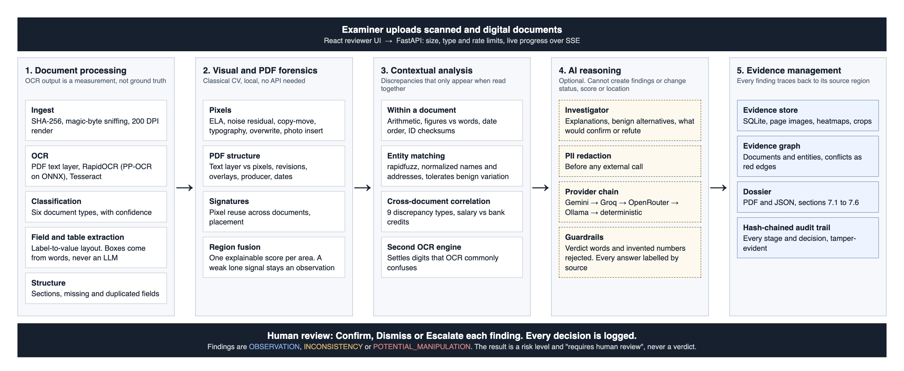

# DocuForensic AI

**OCR reads an altered salary slip perfectly. DocuForensic AI asks whether it should be believed.**

An evidence-driven document investigation engine, built for the DataOps Innovation Hackathon 2026 by
Team Hackthecore. It examines scanned and digital documents for signs of alteration, correlates
information across all the documents in an application, and produces a traceable dossier in which
every finding links back to a region of an original document. It reports observations,
inconsistencies and hypotheses for a human reviewer, and never a verdict. Detection runs entirely on
your machine, and the whole demo works with no API keys.



| | |
|---|---|
|  |  |
| *Cross-document conflicts show both source regions side by side* | *The evidence graph, with conflicts as red edges* |
|  |  |
| *A PDF whose text layer says one thing and whose pixels say another* | *A hash-chained audit trail with Verify integrity* |

## Quick start

Requires Python 3.12, Node 20 and Tesseract (`brew install tesseract`, or
`apt-get install tesseract-ocr`).

```bash
git clone <repo-url> docuforensic && cd docuforensic
```

```bash
make setup
```

```bash
make api
```

In a second terminal:

```bash
make ui
```

Then open http://localhost:5173 and choose **Load demo case**.

**API keys are optional.** With none, all forensics and cross-document checks run locally, and AI
explanations are replayed from answers recorded in real runs, clearly labelled as replays. To use a
local model, install [Ollama](https://ollama.com) and run `ollama pull qwen2.5:7b`. To use hosted
free tiers, copy `.env.example` to `.env`, add keys, and run `make keys`. API docs are at
http://localhost:8000/docs.

## Why this deserves to win

Most document systems stop at "what does it say?" This one asks "should it be believed?", and it can
show its working for every answer.

- **It finds what only appears when documents are read together.** Nine discrepancy types across a
  six-document application, from a DOB that differs by one digit to net pay that doesn't reconcile
  with bank credits. Each conflict shows both source regions side by side.
- **It looks beneath the page.** A PDF can display one number and store another. We compare the text
  layer against the rendered pixels and read the file's revision history, which OCR-only systems
  cannot do.
- **It doesn't cry wolf.** Separate weak signals must corroborate each other before anything is called
  potential manipulation. The clean case raises zero flags, and benign variation such as "Rd." vs "Road"
  isn't treated as a conflict.
- **It keeps humans in charge, verifiably.** Every finding carries benign explanations and verification
  steps. The AI can explain findings but can't create them or change them. Every decision enters a
  tamper-evident audit chain that you can break and detect live.
- **It is honest about itself.** We publish a held-out evaluation, every false positive, and a weak
  result on degraded scans that we could easily have left out.

## What judges should watch during the demo

1. **The salary slip.** The figure says 84,320 and the words on the same page say 48,320. Watch three
   independent forensic signals converge on that exact box.
2. **Case C, Conflicts screen.** Nothing looks visually wrong on these documents. Every discrepancy
   comes from reading them together.
3. **Case D.** A person sees 86,400 and the PDF's text layer says 62,400. An OCR-only or text-only
   pipeline gets a different answer from the one on the page.
4. **Click-through.** Pick any finding and jump to its exact region in the original document, then find
   the same finding in the dossier.
5. **Break the audit chain.** Edit a log entry, press Verify, and see the failure at the exact entry.
6. **Case A and the bad files.** The clean case stays quiet, and a corrupt PDF gets a clear message
   instead of a crash.

## Architecture



Details and data flow: [docs/architecture.md](docs/architecture.md). Methods, with their strengths and
false-positive causes: [docs/models_and_methods.md](docs/models_and_methods.md).

## Features against the rubric

Everything marked below has been run. See the [capability matrix](docs/CAPABILITY_MATRIX.md) for
what is partial, planned or unsupported.

| Criterion | Points | What it does | Evidence |
|---|---|---|---|
| OCR & Extraction | 15 | PDF text layer, RapidOCR (PP-OCR models), Tesseract. Field-level confidence and location, tables, a second engine for ambiguous digits | Fields 232/232 and table rows 108/108 on the demo set |
| Document Understanding | 15 | Six document types, sections, missing and duplicated fields, field relationships | Classification 24/24 |
| Visual Forensics | 15 | ELA, noise residual, copy-move, typography, overwrite, photo insertion, signature reuse, PDF structure, fused per region | Manipulations 6/6 localized, 0 false |
| Contextual Intelligence | 20 | Entity matching, salary and balance arithmetic, figures vs words, 9 cross-document discrepancy types | Discrepancies 13/13 across 9/9 types |
| Evidence & Traceability | 10 | Finding to document, page and region in both directions, evidence graph, audit chain | Automated test walks every finding on all 4 cases |
| AI Reasoning & Explainability | 10 | Benign alternatives and what would confirm or refute each, with the source of every explanation labelled | Run live on a local LLM: 28 calls, 0 errors |
| Technical Implementation | 10 | Typed contracts, 315 tests, CI config, safe failure handling, tested clean clone | See below |
| Innovation | 5 | Text layer vs pixels, second-engine confirmation, counter-hypotheses, verifiable audit tamper demo | Live in the app |

## Benchmark

All data is synthetic and generated by this project. Reproduce with `make benchmark`, and see
[docs/benchmark_results.md](docs/benchmark_results.md) and
[docs/holdout_results.md](docs/holdout_results.md).

| Metric | Demo set | Held-out seeds (5) | Degraded scans (held-out) |
|---|---|---|---|
| Manipulation recall, localized | 6/6 | 30/30 | **11/45 (24.4%)** |
| Manipulation precision | 6/6 | 30/30 | 11/13 (84.6%) |
| Cross-document discrepancy recall | 13/13 | 65/65 | not measured |
| Within-document conflict recall | 6/6 | 30/30 | not measured |
| Field value accuracy | 232/232 | 1160/1160 | 1178/1185 (99.4%) |
| Table row accuracy | 108/108 | 540/540 | not measured |
| Classification accuracy | 24/24 | 120/120 | 105/105 |
| False flags on clean cases | 0 | 0 | 0 |

**How to read this. Please don't read these as real-world accuracy.**

- Held-out seeds change the signatures, photos, paper grain and transactions, but not the templates,
  applicants or tamper types. They test stability, not generalization. **No real documents were used.**
- Thresholds were tuned on the demo set. Earlier held-out rounds found real defects, which we fixed,
  so each round's seeds were used only once and then discarded. One round had 2 false
  `POTENTIAL_MANIPULATION` flags, caused by an OCR line flipped upside down. The table shows the final
  round, after that fix. The history is in [docs/LIMITATIONS.md](docs/LIMITATIONS.md).
- **Degraded scans are a real weakness.** Blur, rotation and heavy JPEG destroy much of the signal, and
  recall falls to about a quarter. Text extraction holds up, so contextual checks keep working.
- The clean case still shows low-confidence observations (11 on the demo set). They are listed in
  the [results](docs/benchmark_results.md) so that you can judge them.

## Capability matrix

Summary below, full version in [docs/CAPABILITY_MATRIX.md](docs/CAPABILITY_MATRIX.md).

| Status | Capabilities |
|---|---|
| **Implemented** | Ingestion of PNG, JPG, scanned and digital PDF; classification; printed OCR; field and table extraction; structure; visual and PDF forensics; signature reuse and placement; contextual and cross-document checks; evidence mapping; dossier; audit trail; reviewer UI; safe failure handling; local LLM reasoning; offline mode |
| **Partial** | Hosted LLMs (Gemini, Groq, OpenRouter: built and tested against a simulated network only, since no keys were available); degraded scans; Docker (written, never run); tablet layout (main screens only) |
| **Planned** | Investigation analytics |
| **Unsupported** | Handwriting recognition; multilingual documents; signature identity verification; checks against external registries; authentication and multiple users |

## Ethics and safety

- **Synthetic data only.** All samples use fictional people and fake IDs and are watermarked SYNTHETIC.
- **No verdicts.** Each finding is an `OBSERVATION`, an `INCONSISTENCY` or a `POTENTIAL_MANIPULATION`.
  The overall result is a risk level and "requires human review".
- **Human oversight.** Reviewers confirm, dismiss or escalate each finding, and each decision is logged.
- **OCR is not ground truth.** Every value keeps its confidence and source location.
- **Bounded AI.** An LLM can't create a finding or change its status, score or location. Answers
  stating a verdict or citing numbers absent from the evidence are rejected.
- **Privacy.** Offline mode makes no external calls, and personal data is redacted before any external
  LLM call.
- **Honest modes.** Each explanation records whether it came from a live LLM, a replay of a real run, or
  deterministic text.
- **Standards.** Aligned with the principles of ISO/IEC 27037, 27041 and 27042 and NIST SP 800-86, with
  no claim of formal compliance. Security review: [docs/SECURITY.md](docs/SECURITY.md).

## AI-assisted development

Significant parts of this project's code, tests and documentation were written with an AI coding
assistant (Claude Code, Anthropic), directed and reviewed by the team, which is responsible for the
result. The application itself can also use LLMs for investigation explanations.

## Limitations

Read [docs/LIMITATIONS.md](docs/LIMITATIONS.md), including expected false positives and unsupported
scenarios. In short: this has never been tested on real documents, layouts must resemble our
templates for field extraction to work well, and a clean result doesn't mean a document is genuine.

## Third-party components and license

This project's own code is under the [MIT License](LICENSE). Third-party components, models and their
licenses are listed in [THIRD_PARTY.md](THIRD_PARTY.md). **PyMuPDF is AGPL-3.0**; read the note there
before distributing or hosting the combined application.

## More documentation

[Problem statement digest](docs/PROBLEM_STATEMENT.md) · [Contracts and API](docs/CONTRACTS.md) ·
[Traceability demo](docs/TRACEABILITY_DEMO.md) · [Sample dossier](docs/sample_dossier.pdf) ·
[Environment](docs/ENVIRONMENT.md) · Docker: `docker compose up --build` (written, but **not yet
tested**)
