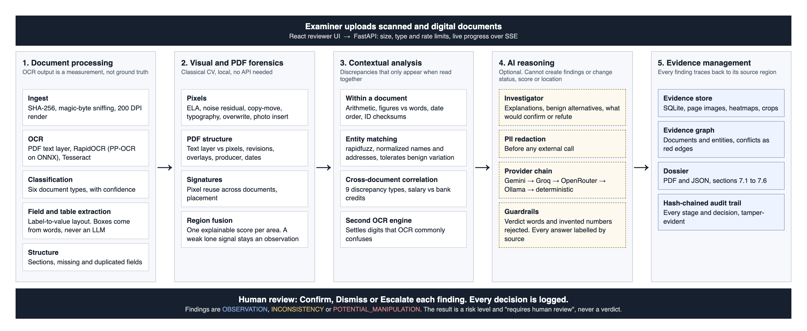
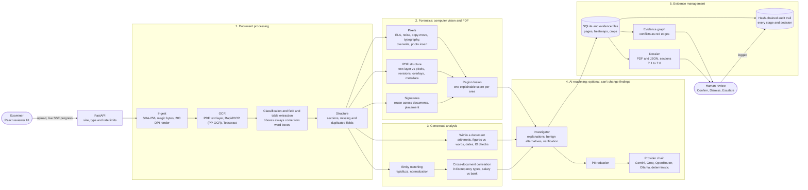

# Architecture

## Overview

DocuForensic AI treats every finding as a first-class evidence object tied to a document, page and
region. Forensic detection and cross-document correlation are deterministic and run locally. An
LLM is optional: it only writes explanations, and it can't create, remove or re-grade a finding.

## Data flow

1. **Submission.** Files are hashed and stored. Type comes from magic bytes, not the extension. A bad
   file becomes a document with an `unsupported` or `failed` status and a message, and never stops
   the case.
2. **Classification, OCR and extraction.** All bboxes are canonical page pixels and come from word
   boxes, never from an LLM. Every field keeps its confidence and source. OCR is never ground truth.
3. **Structure.** Fields are grouped into sections, and missing or duplicated fields are recorded.
4. **Visual forensics.** Detectors run on the page images and PDF internals. Overlapping signals are
   fused into a single scored region.
5. **Contextual verification and correlation.** Field relationships are checked within each document,
   then entities are matched and compared across documents.
6. **Investigation.** Each finding gets an explanation, benign alternatives and verification steps,
   from the LLM when one is available and from deterministic text otherwise. Each finding records
   which of the two produced its text.
7. **Evidence and dossier.** Findings link to their regions, the evidence graph links documents,
   entities and findings, and the dossier follows the required sections.
8. **Human review.** A reviewer decides on each finding. The system itself reports a risk level and
   "requires human review", never a verdict.

## Design decisions

| Decision | Reason |
|---|---|
| Three finding statuses, no verdict | The problem statement requires separating observations, inconsistencies and potential manipulation. |
| The LLM can't alter statuses, severities, confidences or regions | Document text is untrusted and reaches the LLM. See `docs/SECURITY.md`. |
| Detection doesn't depend on any API | The demo and the core product must work with zero keys and no quota. |
| RapidOCR rather than PaddleOCR itself | The same PP-OCR models through ONNX Runtime, without the Paddle framework. See `docs/ENVIRONMENT.md`. |
| ReportLab for the dossier | No system libraries needed, which keeps a clean-clone setup simple. |
| Hash-chained audit log | Tampering with a stored entry is detectable. Aligned with the principles of ISO/IEC 27037 and NIST SP 800-86, with no claim of formal compliance. |
| Canonical pixel coordinates everywhere | One coordinate system links findings, fields, overlays and ground truth. |
